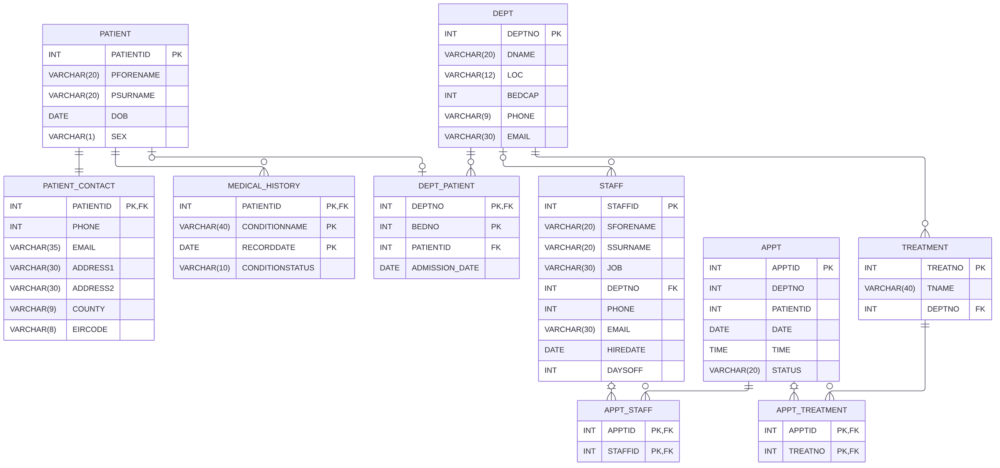
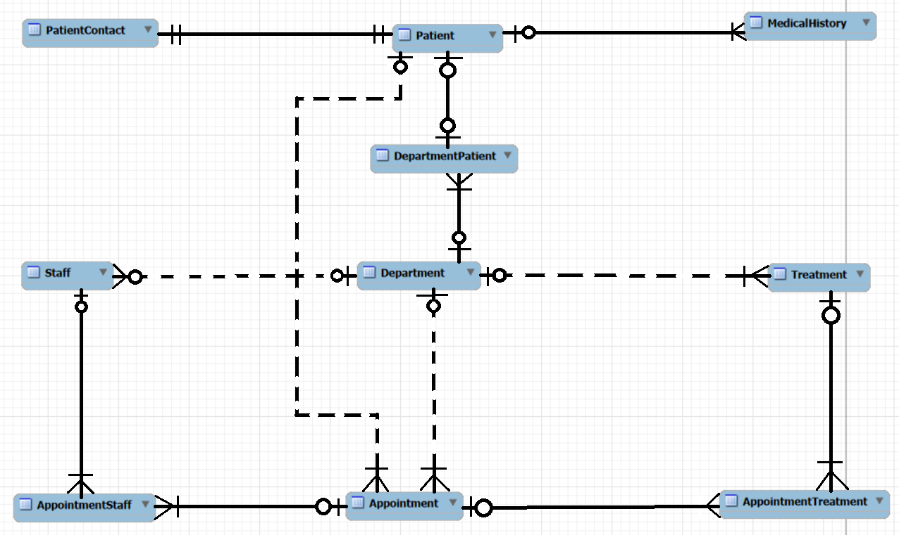
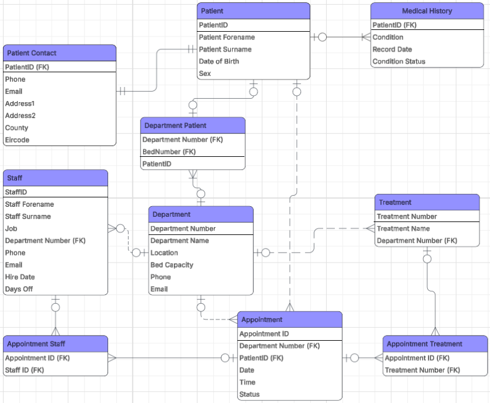
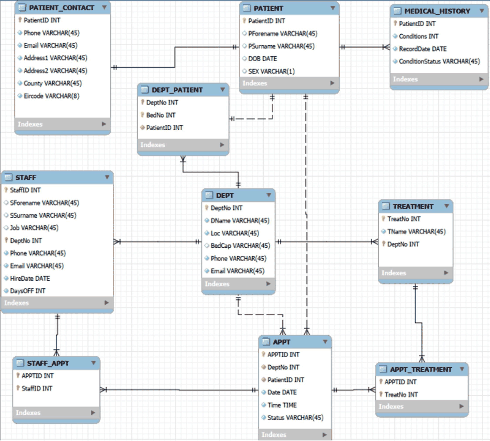

# Hospital Database (MySQL)

A MySQL database I designed and built for a hospital. It covers medical departments and their wards, the treatments each department offers, staff, patients with their medical history and contact details, bed allocation, and appointments with the staff and treatments involved.

Built as the individual project for *Database Fundamentals* (COMP H1029) at TU Dublin. The brief covered the whole process: conceptual, logical and physical ER diagrams, a relational model in third normal form, the DDL and DML to create and fill the database (at least 10 rows per table), and 20 SQL tasks to query and change the data. The design and SQL are my own work; the brief only allowed AI for brainstorming and structuring.


---

## 📂 Repository Structure

```
HospitalDatabase/
├── sql/
│   ├── Task Two – Create & Populate the database.sql   # Creates the database and fills every table
│   └── Task Three – Query The Dataset.sql             # The 20 query tasks, labelled by number
├── diagrams/
│   ├── schema.png                   # The tables as built, drawn from the SQL
│   ├── conceptual_erd.png
│   ├── logical_erd.png
│   ├── physical_erd.png
│   └── conceptual.mwb               # MySQL Workbench model (holds the physical model shown below)
└── documentation/
    └── DBF_project_report.pdf
```

---

## 🗂️ Tables

| Table | What it holds | Rows |
|-------|---------------|:----:|
| `DEPT` | Departments, their floor, bed capacity and contact details | 11 |
| `TREATMENT` | Treatments the hospital offers, and the department that provides each | 15 |
| `STAFF` | Doctors, nurses, healthcare assistants, office and support staff | 30 |
| `PATIENT` | Basic patient details | 30 |
| `PATIENT_CONTACT` | One set of contact details per patient | 30 |
| `MEDICAL_HISTORY` | Each condition a patient has had, when it was recorded and its status | 53 |
| `DEPT_PATIENT` | The beds in each department's ward, and which patient is in each | 30 |
| `APPT` | Appointments: department, patient, date, time and status | 40 |
| `APPT_STAFF` | Which staff worked each appointment | 49 |
| `APPT_TREATMENT` | Which treatments were given at each appointment | 30 |

<p align="center"></p>

A few of the design decisions behind it:

- **Medical history** is keyed on patient, condition and record date together, so the same condition can be recorded more than once (two separate fractures, for example).
- **Beds** are keyed on department and bed number. Every department except Administration has one ward.
- **A staff member's department is optional**, because some staff, like cleaners, don't belong to any one department.
- **Appointments** can involve several staff and several treatments, so both relationships are many-to-many, each with its own junction table (`APPT_STAFF` and `APPT_TREATMENT`).
- `PATIENT_CONTACT`, `MEDICAL_HISTORY` and `DEPT_PATIENT` are weak entities: none of them can exist without the patient or department they belong to.

---

## 📐 Design Diagrams

I worked from a conceptual ERD (entities, relationships and participation), to a logical ERD (attributes and keys), to a physical ERD in MySQL Workbench.

<p align="center">
  
  
</p>
<p align="center">
  
</p>

---

## 🔎 SQL Tasks

All 20 are in [`Task Three – Query The Dataset.sql`](sql/Task%20Three%20%E2%80%93%20Query%20The%20Dataset.sql), labelled by question number.

| # | Task | How |
|:-:|------|-----|
| 1 | Show all departments | `SELECT *` |
| 2 | Contact details for patient 5612 | `WHERE` filter |
| 3 | Update patient 3456's contact details | `UPDATE`, then a `SELECT` to check |
| 4 | Schedule a new appointment | `INSERT` into `APPT`, `APPT_STAFF` and `APPT_TREATMENT`, checked with a 3-table join |
| 5 | Find every patient with diabetes | Join `PATIENT` to `MEDICAL_HISTORY` |
| 6 | Patients under the care of Dr Kavin Smith | 4-table join through appointments and staff |
| 7 | Move Orthopedics patients to a new Orthopedic Surgery department | `INSERT` the department, `UPDATE` the beds |
| 8 | Doctors by hire date, newest first | `ORDER BY ... DESC` |
| 9 | How many patients are having heart surgery | `COUNT(DISTINCT ...)` over a 3-table join |
| 10 | Add one record to every table | `INSERT`s in foreign key order |
| 11 | Delete one record from every table | `DELETE` from each table |
| 12 | Staff days off, fewest first | `ORDER BY ... ASC` |
| 13 | Rename the Office worker job to Administrator | `UPDATE` |
| 14 | Set the Orthopedics phone number to 01-7654321 | `UPDATE` |
| 15 | Rename the CEO to Michael Dean | `UPDATE` |
| 16 | Staff who've worked there for over 3 years | `CURDATE() - INTERVAL 3 YEAR` |
| 17 | Patient names, history, appointments and treatments | Four `LEFT JOIN`s across five tables |
| 18 | How many patients have "road" in their address | `COUNT(*)` with `LIKE` |
| 19 | A view drawing on three tables | `CREATE VIEW` over `PATIENT`, `DEPT_PATIENT` and `PATIENT_CONTACT` |
| 20 | Drop all the information in the appointments relation | `DROP TABLE` |

---

## ▶️ Running It

1. Open MySQL 8 (MySQL Workbench or the command line).
2. Run [`Task Two – Create & Populate the database.sql`](sql/Task%20Two%20%E2%80%93%20Create%20%26%20Populate%20the%20database.sql) to create the `hospital` database and fill it.
3. Run [`Task Three – Query The Dataset.sql`](sql/Task%20Three%20%E2%80%93%20Query%20The%20Dataset.sql). The tasks change the data, so run them in order.

In MySQL Workbench, the Safe Updates setting blocks `UPDATE` and `DELETE` statements that don't filter on a key, which affects several of the tasks. Turn it off under Edit > Preferences > SQL Editor, then reconnect.

---

## 📄 Report

The full [project report (PDF)](documentation/DBF_project_report.pdf) can be viewed in-repo. It covers the entities, business rules and cardinalities behind the design, all three ERDs, the relational model, and screenshots of the query results.
